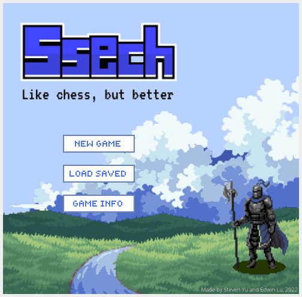

# Ssech

A two-player capture-the-flag strategy game played on a 10x12 board, built with Java Swing.



**Video demo:** https://www.youtube.com/watch?v=NcsZiYu0ms4

## Play

Requires a JDK 17 or newer (`brew install openjdk`, or download one from [Adoptium](https://adoptium.net)).

```sh
./play.sh
```

The script compiles the game into `build/` and launches it. It works from any directory.

Run the test suite with:

```sh
./play.sh test
```

## How to play

Red moves first. Click one of your troops to select it, then click a highlighted square to move there. Moving onto an enemy troop captures it, and moving onto an enemy flag captures the flag. The first player to capture two flags wins.

| Troop  | Range | Ability |
| ------ | ----- | ------- |
| Knight | 1     | |
| Prince | 2     | |
| Fairy  | 1     | Can fly over rivers |
| Wizard | 1     | Can swap places with any troop within 6 squares |
| Bandit | 2     | After a capture, gets one extra move of range 1 |

There are three maps. On **Volcanic**, cracked bridges collapse into lava once a troop steps off them. On **Tundra**, ice weakens every turn a troop stands on it and eventually drowns the troop. Fairies are immune to both. The in-game **Game Info** button has the full rules.

Games autosave after every turn into one of six slots, stored in `~/.ssech/saves`. Set `SSECH_SAVE_DIR` to store them somewhere else.

## Code layout

```
src/main/java/ssech/
  Main.java        entry point
  model/           game rules with no Swing dependencies (BoardState, Rules, Game, Layouts)
  persistence/     save file format (SaveCodec) and slot storage (SaveStore)
  ui/              Swing screens and widgets; rendering only, all logic goes through model.Game
src/main/resources/assets/   images, loaded from the classpath
src/test/java/ssech/         tests, run by a small built-in runner (no external dependencies)
```
